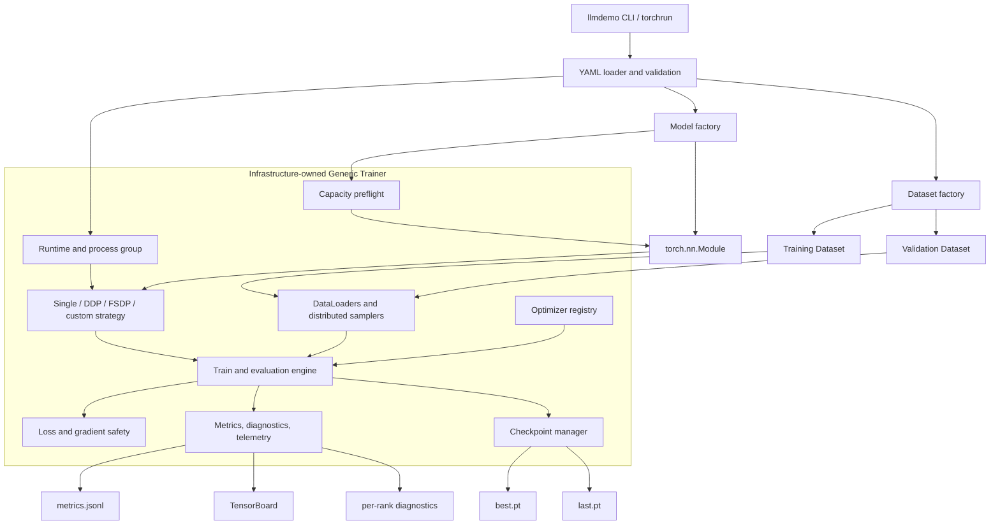
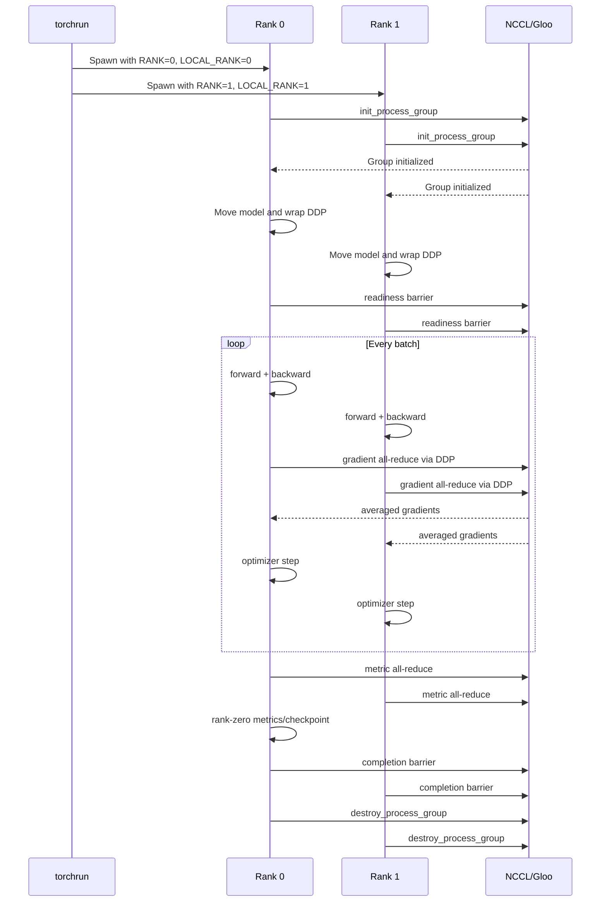
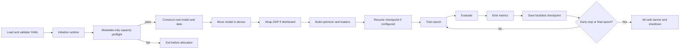

# Generic Trainer: architecture and specification

Status: demonstration/reference implementation  
Package: `generic_trainer`  
CLI: `llmdemo train` or `python -m generic_trainer.cli`  
Last reviewed: 2026-11-04

## 1. Purpose

Generic Trainer is an organization-owned training control plane built directly
on native PyTorch. It separates model and data concerns from infrastructure
concerns so that device support, distributed execution, telemetry, optimizers,
failure policy, and checkpointing can be improved once rather than copied into
every model repository.

It supports conventional neural networks and transformer/LLM-style models that
fit the contract described below. It does not depend on PyTorch Lightning,
Hugging Face Trainer, Accelerate, or DeepSpeed.

### Design objectives

- Accept an ordinary `torch.nn.Module` instead of a framework-specific model.
- Resolve model and dataset factories from versioned YAML.
- Run the same model on CPU, Apple MPS, one CUDA GPU, or CUDA DDP.
- Keep optimizer, precision, accumulation, logging, and failure policy outside
  model code.
- Fail early on malformed configuration, unsafe loss, non-finite gradients,
  unavailable devices, missing optional dependencies, and estimated memory
  insufficiency.
- Produce machine-readable metrics, diagnostics, checkpoints, and a resolved
  configuration for every run.
- Make distributed behavior observable at the rank and collective level.

### Non-goals in the current version

- Reinforcement learning, GAN, or multi-optimizer training loops.
- Arbitrary optimizer closures such as LBFGS.
- Streaming datasets without a meaningful `__len__`.
- Elastic membership changes or automatic worker-group recovery.
- A complete production model registry or distributed object-storage backend.

DDP and YAML-selectable model-parallel strategies remain supported because
they were requested separately after the original non-goals expansion.

## 2. High-level architecture



### Ownership boundary

| Concern | Model/data team | Infrastructure team |
|---|---:|---:|
| Network architecture and forward pass | Yes | No |
| Domain loss and output interpretation | Yes | No |
| Feature/token preprocessing | Yes | No |
| Dataset schema and examples | Yes | No |
| Device and backend selection | No | Yes |
| DDP lifecycle and collectives | No | Yes |
| Mixed precision and gradient scaling | No | Yes |
| Optimizer construction | Configuration only | Yes |
| Accumulation and clipping | Configuration only | Yes |
| Metrics, diagnostics, telemetry | No | Yes |
| Checkpoint and resume behavior | No | Yes |
| Failure and early-stopping policy | Configuration only | Yes |

## 3. Model contract

A model factory receives the `model` YAML mapping, excluding `factory`, and
returns a `torch.nn.Module`.

```python
def build_model(config: dict) -> torch.nn.Module:
    return MyModel(**config)
```

During training, `forward(**batch)` must return a dictionary containing a
scalar tensor named `loss`:

```python
class MyModel(torch.nn.Module):
    def forward(self, features, labels=None):
        predictions = self.network(features)
        result = {"predictions": predictions}
        if labels is not None:
            result["loss"] = torch.nn.functional.mse_loss(predictions, labels)
        return result
```

Required behavior:

- `loss` must be a zero-dimensional tensor when labels/targets are supplied.
- All batch keys must either be accepted by `forward` or captured by `**kwargs`.
- Domain-specific loss construction belongs in the model, not the trainer.
- Optional outputs such as `predictions`, `logits`, or embeddings are allowed.
- Parameters must be visible through `model.parameters()`.

The model must not initialize process groups, select CUDA devices, construct
the optimizer, create TensorBoard writers, or own the epoch loop.

## 4. Dataset contract

A data factory receives the `data` YAML mapping, excluding `factory`, plus the
run seed. It returns `(training_dataset, validation_dataset)`.

```python
def build_datasets(config: dict, seed: int):
    return train_dataset, validation_dataset
```

Each dataset item must be a dictionary compatible with the model's forward
signature:

```python
{
    "features": torch.Tensor(...),
    "labels": torch.Tensor(...),
}
```

The engine expects finite datasets with a meaningful `__len__`. Under
DDP/FSDP it creates a `DistributedSampler`, gives every rank a deterministic
shard, and calls `sampler.set_epoch(epoch)` before each epoch.

## 5. Factory resolution

Factories use `module:function` syntax:

```yaml
model:
  factory: models.housing_llm.factory:build_model

data:
  factory: models.housing_llm.factory:build_datasets
```

Factories are imported dynamically. Unknown modules, missing functions, or
non-callable attributes fail before training begins.

## 6. Runtime and device selection

The requested device is conveyed through `LLMDEMO_DEVICE`, normally set by the
CLI's `--device` option.

| Value | Behavior |
|---|---|
| `auto` | CUDA first, then single-process MPS, then CPU |
| `cpu` | Force CPU and Gloo for DDP |
| `cuda` | Require CUDA; fail if unavailable; use NCCL for DDP |
| `mps` | Require Apple MPS; fail if unavailable; single process only |

Examples:

```bash
llmdemo train --config configs/smoke.yaml --device cpu
llmdemo train --config configs/train_500m.yaml --device mps
llmdemo train --config configs/train_1b.yaml --device cuda --num-processes 4
```

The CLI uses `torch.distributed.run` for local multi-GPU execution. `torchrun`
supplies `RANK`, `LOCAL_RANK`, and `WORLD_SIZE`; the trainer does not invent or
manually assign global ranks.


## 7. Distributed execution



Properties:

- One process owns one CUDA GPU.
- CPU DDP uses Gloo; CUDA DDP uses NCCL.
- DDP replicates the entire model and optimizer on each rank.
- FSDP shards parameters, gradients, and optimizer state across ranks.
- Accumulation batches use `DDP.no_sync()` until the update boundary.
- Rank zero writes shared metrics and checkpoints.
- Every rank writes its own diagnostic stream when diagnostics are enabled.
- A configured process-group timeout bounds collective hangs.

Adding DDP ranks improves data-parallel throughput but does **not** make a
model fit into smaller per-GPU memory. Select FSDP or a model-specific
tensor/pipeline strategy when memory—not throughput—is the constraint.

## 8. Training lifecycle



Within a training batch:

1. Recursively move tensor values to the selected device.
2. Enter autocast when CUDA FP16/BF16 is enabled.
3. Call `model(**batch)` and validate scalar `loss`.
4. Trigger the non-finite/exploding-loss circuit breaker.
5. Scale the loss by accumulation steps and call backward.
6. On an update boundary, unscale FP16 gradients.
7. Clip the global gradient norm and reject non-finite gradients.
8. Update learning rate using warmup/cosine policy.
9. Step the configured optimizer and scaler.
10. Emit step metrics and optional hardware/diagnostic events.

## 9. Configuration specification

### Top-level sections

| Section | Purpose |
|---|---|
| `run` | Run identity, seed, and artifact directory |
| `model` | Model factory and model-specific arguments |
| `data` | Dataset factory and data-specific arguments |
| `trainer` | Infrastructure and optimization policy |

### `run`

```yaml
run:
  name: housing-llm-500m
  seed: 42
  output_dir: artifacts/housing-llm-500m
```

### Core `trainer` fields

| Field | Type | Meaning |
|---|---|---|
| `max_epochs` | integer | Maximum full dataset passes |
| `train_batch_size` | integer | Per-rank training microbatch |
| `eval_batch_size` | integer | Per-rank validation batch |
| `gradient_accumulation_steps` | integer | Microbatches per optimizer update |
| `scheduler.name` | `constant`, `cosine`, `linear` | Learning-rate policy; default `cosine` |
| `scheduler.warmup_steps` | integer | Linear warmup update count; default `0` |
| `scheduler.minimum_lr_ratio` | float | Learning-rate floor relative to base LR; default `0.1` |
| `max_grad_norm` | float | Global gradient clipping threshold |
| `precision` | `fp32`, `fp16`, `bf16`, `auto` | CUDA autocast policy |
| `compile` | boolean | Enable `torch.compile` when available |
| `num_workers` | integer | DataLoader worker count |
| `log_every_steps` | integer | Rank-zero training metric interval |
| `save_every_epochs` | integer | `last.pt` checkpoint interval |
| `resume_from` | path/null | Checkpoint from which to resume |
| `model_parallelism.name` | string | `none`, `fsdp`, `tensor_parallel`, or `pipeline_parallel` |
| `model_parallelism.tensor_parallel_size` | integer | Ranks in each tensor-parallel group |
| `model_parallelism.pipeline_parallel_size` | integer | Pipeline stages per model replica |
| `model_parallelism.data_parallel_size` | integer/`auto` | Replica count; validated against world size |

### Resolved defaults for omitted hyperparameters

The loader resolves every omitted supported hyperparameter before model or
optimizer construction. Resolved values are written to `resolved_config.yaml`
and embedded in checkpoints, so a default is visible and reproducible rather
than an undocumented PyTorch behavior. Explicit YAML always wins. Unknown
fields and invalid values fail instead of being silently ignored.

| Omitted field | Generic Trainer default | Meaning |
|---|---:|---|
| `trainer.max_epochs` | `1` | Make one complete pass through training data |
| `trainer.train_batch_size` | `32` | Process 32 examples per rank and microbatch |
| `trainer.eval_batch_size` | `32` | Evaluate 32 examples per rank and batch |
| `trainer.gradient_accumulation_steps` | `1` | Update after every microbatch |
| `trainer.optimizer.name` | `adamw` | Use AdamW when neither optimizer nor legacy learning rate is supplied |
| `trainer.optimizer.parameters.lr` | `0.001` | AdamW base learning rate |
| `trainer.optimizer.parameters.weight_decay` | `0.01` | Decoupled weight decay |
| `trainer.optimizer.parameters.betas` | `[0.9, 0.999]` | First and second moment decay |
| `trainer.optimizer.parameters.eps` | `1e-8` | Numerical-stability term |
| `trainer.scheduler.name` | `cosine` | Decay from base LR using a cosine curve after warmup |
| `trainer.scheduler.warmup_steps` | `0` | Start at base LR without warmup |
| `trainer.scheduler.minimum_lr_ratio` | `0.1` | Do not decay below 10 percent of base LR |
| `trainer.max_grad_norm` | `1.0` | Clip global gradient norm to 1.0 |
| `trainer.precision` | `auto` | Select BF16 or FP16 on compatible CUDA; otherwise FP32 |
| `trainer.compile` | `false` | Do not invoke `torch.compile` |
| `trainer.num_workers` | `0` | Load data in the training process |
| `trainer.log_every_steps` | `20` | Emit step metrics every 20 optimizer updates |
| `trainer.save_every_epochs` | `1` | Save `last.pt` every epoch |
| `trainer.early_stopping.patience` | `3` | Stop after three validation epochs without improvement |
| `data.shuffle_train` | `true` | Deterministically reshuffle training indices each epoch |
| `data.shuffle_validation` | `false` | Preserve validation order |
| `data.drop_last` | `false` | Keep a smaller final training batch |
| `trainer.model_parallelism.name` | `none` | Use single process or DDP; do not activate model parallelism |

Defaults are a runnable baseline, not a claim that they are optimal for every
model. Production YAML should specify reviewed values for optimizer, learning
rate, scheduler, batch size, precision, clipping, and stopping policy.

### Generic run comparison

Compare any two standard artifact directories without importing model code:

```bash
llmdemo compare \
  --before artifacts/baseline \
  --after artifacts/candidate \
  --output artifacts/comparison \
  --before-label Baseline \
  --after-label Candidate
```

The inputs must contain epoch events in `metrics.jsonl` and model tensors in
`last.pt`. The output includes loss curves, final-loss bars, absolute and
percentage differences, `Loss Improved`, checkpoint tensor norms, and a JSON
report. Because the utility is model-independent, domain prediction plots
require a separate model-specific evaluator.

### Best Practices for Model Owners and MLOps

There is no universally ideal hyperparameter configuration. The right values
depend on the model, objective, data distribution, effective batch size,
hardware, and acceptable training time. Treat the settings below as reviewed
starting points. Promote them only after comparing convergence, validation
quality, throughput, memory, and restart behavior against a baseline.

#### Ownership boundary

Model owners should own the network, forward contract, domain loss, data
schema, target metric, and evidence that a configuration learns the intended
task. MLOps and AI infrastructure should own reproducible configuration,
device and topology policy, artifact retention, checkpoint recovery,
telemetry, and promotion gates. Neither team should change optimizer or
scaling policy without preserving the resolved YAML and comparison evidence.

#### Start with effective batch size

The optimization batch is larger than the per-rank YAML batch when using
accumulation or DDP:

```text
effective batch size = train batch size per rank
                     × gradient accumulation steps
                     × data parallel ranks
```

For example, `train_batch_size: 16`, accumulation `8`, and four DDP ranks
produce an effective batch of `512`. Increasing world size without reviewing
this value changes optimization behavior even when model code is unchanged.
Larger effective batches usually improve throughput and reduce gradient noise,
but may require learning-rate tuning and can generalize worse. Smaller batches
use less memory and provide noisier gradients, but require more optimizer steps
for the same number of examples.

#### Recommended starting points by workload

| Workload | Optimizer and schedule starting point | What to measure before promotion |
|---|---|---|
| Small regression or classification model | AdamW at `1e-3` with weight decay `1e-2`, or SGD at `1e-2` when matching a known baseline; constant or cosine schedule | Validation loss and domain metric, overfitting gap, CPU or GPU throughput |
| Transformer fine-tuning | AdamW in the approximate `1e-5` to `5e-5` range, weight decay near `1e-2`, short warmup, linear or cosine decay | Catastrophic forgetting, validation metric, seed variance, calibration |
| Transformer training from scratch | AdamW near `1e-4` to `3e-4`, betas often starting at `[0.9, 0.95]`, weight decay near `0.1`, warmup followed by cosine decay | Loss stability, gradient norm, examples per second, memory, scaling efficiency |
| Stable legacy parity run | Copy the legacy optimizer, learning rate, schedule, batch, shuffle, clipping, seed, and epoch policy exactly | Near-overlapping loss curves and equivalent evaluation output |
| Large model that does not fit on one GPU | Keep optimizer tuning separate from topology selection; validate FSDP or an explicit model-parallel adapter | Per-rank peak memory, collective time, throughput, checkpoint save and resume |

These ranges are experiment seeds, not production guarantees. Dataset size,
normalization, loss scale, parameter count, pretraining history, and effective
batch size can move the appropriate learning rate by orders of magnitude.

#### Consequences of major hyperparameters

| Configuration choice | If too low or disabled | If too high or aggressive | Evidence to inspect |
|---|---|---|---|
| Learning rate | Slow learning, flat loss, wasted epochs | Oscillation, divergence, non-finite loss, degraded validation | Step loss, validation loss, gradient norm |
| Warmup steps | Early instability for sensitive or large models | Too much run time spent below a useful learning rate | Early-step loss and learning-rate trace |
| Weight decay | Overfitting or large parameter norms | Underfitting and suppressed useful weights | Train-validation gap and checkpoint norms |
| Batch size | Lower utilization and noisy updates | More memory, fewer updates, possible generalization degradation | Throughput, peak memory, validation metric |
| Gradient accumulation | More frequent synchronization and updates | Slower feedback and a much larger effective batch | Optimizer steps, throughput, effective batch |
| Gradient clipping | Exploding updates can terminate training | Legitimate gradients are repeatedly truncated and learning slows | Gradient norm before clipping and loss slope |
| Epoch count | Underfitting | Overfitting, excess cost, or data memorization | Train and validation curves |
| Early-stopping patience | Useful runs can stop on normal validation noise | Stalled or overfitting runs consume resources | Best epoch, stopping epoch, validation variance |
| Training shuffle | Order bias and correlated batches | Usually desirable, but complicates exact parity debugging | Seeded repeatability and batch-level loss |
| `drop_last` | A smaller last batch may affect normalization or timing | Dropping data can bias small datasets | Example counts and last-batch size |
| FP16 or BF16 | FP32 costs more memory and compute | FP16 can overflow or underflow; unsupported precision fails | Non-finite events, scaler behavior, memory and throughput |
| DDP rank count | Lower aggregate throughput | Communication overhead and changed effective batch can erase gains | Scaling efficiency, unused GPUs, collective duration |

#### Evaluation best practices

- Keep training and validation examples disjoint and prevent target leakage.
- Set `shuffle_validation: false` so evaluation order is stable.
- Use the same preprocessing contract for baseline and candidate runs.
- Track loss and a domain metric. The current core trainer optimizes and
  early-stops on `val_loss`; accuracy, F1, RMSE, calibration, or ranking
  metrics require a model-specific evaluator until the metric registry exists.
- Compare more than the final epoch. Inspect learning curves, best epoch,
  train-validation gap, gradient norms, throughput, and memory.
- Repeat promotion candidates across multiple seeds when variance could change
  the decision.
- Evaluate on an untouched test set only after configuration selection. Do not
  repeatedly tune against the test set.

#### Checkpoint and operational best practices

- Save the resolved configuration with every run; never rely on remembered
  command-line values.
- Keep `best.pt` for model selection and `last.pt` for operational resume; do
  not assume they represent the same epoch.
- Test resume before a long job. Confirm epoch, global step, optimizer state,
  topology, and loss continue as expected.
- Treat direct `torch.save` publication as a current demo limitation. Require
  atomic publication, checksums, schema validation, and last-known-good
  retention before production recovery depends on these files.
- Record model version, data version, container digest, PyTorch and CUDA
  versions, world size, and resolved YAML in platform metadata.
- Run CPU/Gloo contract tests and target-image CUDA/NCCL tests before promoting
  a trainer or container change.

#### Reviewed YAML example

This is a reasonable starting point for a medium-size transformer-style run,
not a universally optimal recipe:

```yaml
run:
  name: reviewed-transformer-baseline
  seed: 42
  output_dir: artifacts/reviewed-transformer-baseline

data:
  factory: your_package.data:build_datasets
  num_examples: 1000000
  shuffle_train: true
  shuffle_validation: false
  drop_last: false

model:
  factory: your_package.model:build_model

trainer:
  max_epochs: 10
  train_batch_size: 16
  eval_batch_size: 32
  gradient_accumulation_steps: 8

  optimizer:
    name: adamw
    parameters:
      lr: 0.0002
      weight_decay: 0.1
      betas: [0.9, 0.95]
      eps: 1.0e-8

  scheduler:
    name: cosine
    warmup_steps: 500
    minimum_lr_ratio: 0.1

  precision: auto
  max_grad_norm: 1.0
  compile: false
  num_workers: 4
  log_every_steps: 20
  save_every_epochs: 1
  resume_from: null

  early_stopping:
    metric: val_loss
    mode: min
    patience: 3
    min_delta: 0.0001

  safety:
    stop_on_non_finite_loss: true
    max_loss: 1000000.0
    max_consecutive_skips: 1

  telemetry:
    enabled: true
    log_every_steps: 20

  model_parallelism:
    name: none
    tensor_parallel_size: 1
    pipeline_parallel_size: 1
    data_parallel_size: auto
```

For a four-rank DDP launch, this example has an effective training batch of
`16 × 8 × 4 = 512`. If that is not the intended optimization batch, reduce
the per-rank batch or accumulation before changing the learning rate.

#### Promotion checklist

1. Establish a fixed baseline with resolved YAML and a known checkpoint.
2. Change one policy family at a time, such as optimizer and scheduler or
   batch and accumulation.
3. Use `llmdemo compare` to measure absolute and percentage loss differences.
4. Confirm the domain metric, not only loss, improves or remains within an
   approved tolerance.
5. Confirm throughput, memory, GPU assignment, and collective overhead justify
   the requested hardware.
6. Resume from a saved checkpoint and verify continuity.
7. Repeat with additional seeds or data slices when variance is material.
8. Promote the exact resolved YAML, code version, image, and artifact lineage
   that passed review.

### Runtime environment defaults

Runtime variables can be versioned with the training configuration and are
applied before device selection and distributed process-group initialization:

```yaml
trainer:
  environment:
    override_existing: false
    variables:
      NCCL_DEBUG: INFO
      NCCL_DEBUG_SUBSYS: INIT,COLL
      TORCH_DISTRIBUTED_DEBUG: INFO
      TORCH_NCCL_ASYNC_ERROR_HANDLING: "1"
      TORCH_SHOW_CPP_STACKTRACES: "1"
```

`override_existing: false` is the recommended default. It means values set by
the shell, Equinix image, Slurm/Kubernetes job, or platform operator take
precedence over YAML. Set it to `true` only when the run configuration must
enforce an exact value.

For safety, only variables beginning with `NCCL_`, `TORCH_`, `CUDA_`,
`GLOO_`, `OMP_`, or `FI_` are accepted. Structured/null values and unrelated
process variables such as `PATH` are rejected. Effective values are included
in the rank-zero startup JSON event.

The NCCL settings are inert during CPU/Gloo and Apple MPS runs. Avoid
`NCCL_DEBUG: TRACE` or `TORCH_DISTRIBUTED_DEBUG: DETAIL` for sustained
production training unless investigating a problem, because they can produce
large logs and add synchronization/debug overhead.

`fp16` and `bf16` autocast are currently enabled only for CUDA. CPU and MPS
runs remain FP32 in this implementation.

### Optimizer

```yaml
trainer:
  optimizer:
    name: adamw
    parameters:
      lr: 0.0002
      weight_decay: 0.1
      betas: [0.9, 0.95]
      eps: 1.0e-8
```

Core choices:

- `sgd`
- `adam`
- `adamw`
- `rmsprop`
- `adagrad`
- `adadelta`
- `nadam`
- `radam`

`distributed_shampoo` is supported through Meta's optional package. Unknown
optimizer names and misspelled parameters fail; no fallback optimizer is used.
LBFGS remains excluded because the standard loop does not implement arbitrary
optimizer closures.

### Data and model parallelism

The choice is explicit in YAML. The safe default is:

```yaml
trainer:
  model_parallelism:
    name: none
    tensor_parallel_size: 1
    pipeline_parallel_size: 1
    data_parallel_size: auto
```

`name: none` means **no model parallelism**. A one-process launch remains
single-process; a multi-process launch uses ordinary DDP across every rank.
The trainer never silently changes a DDP job into FSDP, tensor parallelism, or
pipeline parallelism.

The topology follows:

```text
world_size = data_parallel_size × tensor_parallel_size × pipeline_parallel_size
```

`data_parallel_size: auto` derives the remaining dimension. Explicit values
must match the derived value, and non-divisible world sizes fail before model
wrapping.

#### FSDP

```yaml
trainer:
  model_parallelism:
    name: fsdp
    tensor_parallel_size: 1
    pipeline_parallel_size: 1
    data_parallel_size: auto
    parameters:
      sharding_strategy: FULL_SHARD
      use_orig_params: true
      cpu_offload: false
      limit_all_gathers: true
      forward_prefetch: false
      sync_module_states: false
```

Useful FSDP parameters:

| Parameter | Meaning |
|---|---|
| `sharding_strategy` | `FULL_SHARD`, `SHARD_GRAD_OP`, `NO_SHARD`, or `HYBRID_SHARD` |
| `use_orig_params` | Preserve original parameter views for optimizer compatibility |
| `cpu_offload` | Offload parameters/gradients to CPU; reduces GPU memory but adds transfer cost |
| `limit_all_gathers` | Rate-limit pre-forward all-gathers to reduce peak memory |
| `forward_prefetch` | Prefetch the next all-gather for static graphs |
| `sync_module_states` | Broadcast module state from rank zero during construction |

#### Tensor or pipeline parallelism

Tensor/pipeline partitioning depends on the model graph and therefore requires
an adapter plus explicit topology:

```yaml
trainer:
  model_parallelism:
    name: tensor_parallel       # or pipeline_parallel
    factory: my_project.parallel:build_strategy
    tensor_parallel_size: 4
    pipeline_parallel_size: 1
    data_parallel_size: auto
    parameters:
      sequence_parallel: true
```

The factory receives the strategy mapping and returns an object implementing
`wrap(model, runtime, config) -> nn.Module`. This makes partition plans
reviewable and testable instead of using fragile automatic layer guesses.
Pipeline adapters can additionally consume fields such as `microbatches`,
`schedule`, `split_points`, and `activation_checkpointing` from `parameters`.
A complete set of copyable snippets is in
[`configs/model_parallelism_examples.yaml`](../../configs/model_parallelism_examples.yaml).

### Early stopping

```yaml
early_stopping:
  metric: val_loss
  mode: min
  patience: 3
  min_delta: 0.0001
```

The current engine evaluates `val_loss`. The `metric` field documents intent,
but arbitrary validation metric selection is not implemented yet.

### Safety policy

```yaml
safety:
  stop_on_non_finite_loss: true
  max_loss: 100.0
  max_consecutive_skips: 2
```

- NaN or infinity can stop the job immediately.
- Loss above `max_loss` is treated as an explosion.
- Non-finite gradient norm always stops the job.
- Optimizer state is never updated for a rejected batch.

### Diagnostics

```yaml
diagnostics:
  enabled: true
  log_every_batches: 10
  collective_timeout_seconds: 600
  fail_fast_capacity_check: true
  capacity:
    bytes_per_parameter: 20.0
    activation_reserve_gib: 4.0
    max_memory_fraction: 0.9
    require_memory_check: true
```

Capacity preflight builds the model on PyTorch's `meta` device and estimates
per-rank training memory before constructing real weights. The default 20 bytes
per parameter is a conservative approximation for FP32 weights, gradients,
Adam-like optimizer state, and transient overhead; activation reserve is added
separately. It is a guardrail, not a precise memory profiler.

### Telemetry

```yaml
telemetry:
  enabled: true
  log_every_steps: 20
```

CUDA telemetry combines rank-local PyTorch allocator values with `nvidia-smi`
physical GPU inventory. When `nvidia-smi` is absent, training continues and the
inventory is empty. Apple MPS does not provide NVIDIA telemetry.

### Overrides

Only existing configuration paths may be overridden:

```bash
llmdemo train --config configs/smoke.yaml --device cpu \
  --set trainer.max_epochs=2 \
  --set data.num_examples=1024
```

Unknown override paths fail to prevent silent typographical errors.

## 10. Optimizer and schedule behavior

The optimizer registry validates constructor parameters against the selected
PyTorch optimizer signature. YAML lists for `betas` are normalized to tuples.
Optimizer state is saved and restored with checkpoints.

The engine selects `constant`, `cosine`, or `linear` scheduling from YAML. All
three can use linear warmup. Cosine and linear policies honor
`minimum_lr_ratio`; the default is cosine with a floor of 10 percent of the
configured base learning rate. The hello-world parity configuration selects
`constant` so its `0.01` rate matches the legacy loop exactly.

```yaml
trainer:
  scheduler:
    name: cosine
    warmup_steps: 0
    minimum_lr_ratio: 0.1
```

Shampoo is optional because it adds material compute, memory, dependency, and
version constraints. See Meta's
[Distributed Shampoo documentation](https://github.com/facebookresearch/optimizers/tree/main/distributed_shampoo).

## 11. Checkpoints and resume

Rank zero writes:

```text
artifacts/<run>/
├── best.pt
├── last.pt
├── metrics.jsonl
├── resolved_config.yaml
├── diagnostics/
│   ├── rank-0.jsonl
│   └── rank-N.jsonl
└── tensorboard/
```

Each checkpoint contains:

- Unwrapped model `state_dict`
- Optimizer `state_dict`
- Completed epoch
- Global optimizer step
- Best validation metric
- Full resolved configuration

Current limitations:

- Scheduler state is implicit in `global_step`, not independently serialized.
- AMP scaler state is not currently saved.
- Checkpoints use local `torch.save`; production object storage and distributed
  checkpointing require an adapter.
- A changed model or optimizer configuration may be incompatible with a saved
  state and will fail while loading.

## 12. Observability

### Metrics

`metrics.jsonl` and TensorBoard include step/epoch information such as:

- Training and validation loss
- Learning rate
- Gradient norm
- Examples per second
- Model parameter and byte counts
- Rank/device placement
- CUDA utilization and memory inventory
- Unused physical GPU indices

### Per-rank diagnostics

When enabled, every rank writes flush-on-write JSONL events covering:

- Process-group initialization
- Model device placement
- DDP wrapping
- Rank barriers
- Forward/backward/optimizer durations
- Metric all-reduce start and completion
- Evaluation
- Checkpoint writes
- Successful completion or failure type/message

Per-batch diagnostic logging is expensive. Use interval `1` for investigation
and a larger interval, such as `50` or `100`, for sustained workloads.

## 13. Failure model

| Failure | Behavior |
|---|---|
| Requested CUDA/MPS unavailable | Fail before model training |
| Unsupported MPS distributed request | Fail during runtime initialization |
| Invalid YAML structure | Fail before factory construction |
| Unknown override path | Fail before training |
| Unknown optimizer or parameter | Fail before first batch |
| Shampoo package missing | Fail; never substitute another optimizer |
| Estimated memory insufficient | Fail before real model allocation |
| Non-scalar/missing model loss | Fail on first affected batch |
| NaN/inf/excessive loss | Fail or skip according to safety policy |
| Non-finite gradient norm | Fail before optimizer update |
| Collective hang | Process group fails after configured timeout |
| Rank failure | Other ranks eventually fail through DDP/collective timeout |

The trainer is fail-fast where it can prove a condition locally. It cannot
guarantee recovery from machine loss or network partition; production systems
still need a scheduler with gang semantics and job retry policy.

## 14. Security and production hardening

Factory paths execute imported Python code. Treat YAML and model packages as
trusted code, not as untrusted user input.

Recommended production controls:

- Build signed, immutable CPU and CUDA container images.
- Pin Python, PyTorch, CUDA, NCCL, and package hashes.
- Generate and scan an SBOM.
- Run CPU/Gloo and CUDA/NCCL collective tests before promotion.
- Store artifacts in versioned object storage or a model registry.
- Record container digest, Git commit, dataset version, and resolved YAML.
- Run with least-privilege filesystem and network permissions.
- Validate public data URLs against an allowlist rather than accepting arbitrary
  remote content.
- Add retention policy, checkpoint encryption, and secret redaction.
- Avoid per-batch logging of sensitive features or labels.

## 15. Comparison with established frameworks

This section is a decision guide, not a claim that a small custom trainer has
feature parity with mature open-source frameworks.

### Summary matrix

| Dimension | Generic Trainer | PyTorch Lightning | HF Trainer | HF Accelerate | DeepSpeed |
|---|---|---|---|---|---|
| Primary abstraction | Organization-owned loop | `LightningModule` + `Trainer` | Transformer-oriented complete trainer | Distributed adaptation layer | Large-scale training runtime |
| Ordinary `nn.Module` | Native contract | Usually wrapped/reorganized | Supported with HF-like behavior | Yes | Yes, with engine integration |
| Owns full loop | Yes | Yes | Yes | No; user keeps loop | Often engine/config-driven |
| DDP | Yes | Yes | Yes | Yes | Yes |
| FSDP | Built in | Available strategies | Available through arguments/integration | Available | Integrates with broader stacks |
| ZeRO sharding | No | Via integrations/plugins | Via DeepSpeed integration | Via DeepSpeed integration | Multiple ZeRO stages |
| Tensor/pipeline parallel | Model strategy adapter | Strategy/plugin dependent | Integration dependent | Integration dependent | Built-in/advanced |
| Specialized loops | No | Hooks/manual optimization | Subclass/callback paths | User-owned | Engine/user integration |
| Streaming data | Finite datasets only | Supported | Iterable datasets | User-owned | Supported |
| Elastic recovery | No automatic recovery | Environment/strategy dependent | Integration dependent | Launcher dependent | Launcher/checkpoint dependent |
| TPU/HPU/XPU breadth | No | Broad strategy/plugin ecosystem | Broad via integrations | Broad | Primarily accelerator/HPC focus |
| Transformer ecosystem | Neutral | Neutral | Strongest | Strong | Strong integration ecosystem |
| Custom infra observability | Direct and explicit | Hooks/plugins | Callbacks/subclassing | User-owned loop | Engine hooks and profiler ecosystem |
| Dependency footprint | Small | Additional framework | Transformers stack | Accelerate stack | DeepSpeed/native build stack |
| Maintenance burden | Entirely internal | Shared upstream | Shared upstream | Shared upstream | Shared upstream |
| Best fit | Stable internal contract and policy demonstration | General research/production with batteries included | HF model fine-tuning | Existing custom loops needing portability | Models requiring memory/performance scaling |

### Versus PyTorch Lightning

Lightning's `Trainer` automates loops, devices, validation, callbacks,
precision, logging, checkpointing, and distributed strategies after code is
organized as a `LightningModule`. Its strategy and plugin interfaces cover
considerably more hardware and lifecycle scenarios than this trainer. See the
[Lightning Trainer documentation](https://lightning.ai/docs/pytorch/stable/common/trainer.html).

Generic Trainer advantages:

- Smaller abstraction surface and dependency graph.
- Ordinary `nn.Module` contract with organization-specific batch/loss policy.
- Infrastructure behavior and diagnostic events are directly visible.
- Easier to enforce a narrow internal standard and custom failure semantics.
- Useful as a teaching/demo artifact for model/infrastructure separation.

Generic Trainer disadvantages:

- The organization owns correctness, compatibility, testing, and upgrades.
- Far fewer strategies, callbacks, profilers, plugins, and hardware targets.
- No TPU/HPU ecosystem or mature callback lifecycle; FSDP is narrower than
  Lightning's strategy implementation.
- Less community testing and fewer integrations.

Choose Lightning when its module/hook model is acceptable and the team values
broad capability over owning a narrow loop. Choose Generic Trainer when the
primary requirement is a controlled internal contract and the missing features
are explicitly funded and tested.

### Versus Hugging Face Trainer

Hugging Face Trainer is a complete training and evaluation loop optimized for
Transformers models, with `TrainingArguments`, data collators, callbacks, Hub
integration, and extensive fine-tuning behavior. It can accept custom
`nn.Module` models when they behave like Transformers models. See the
[HF Trainer guide](https://huggingface.co/docs/transformers/main/trainer) and
[Trainer API](https://huggingface.co/docs/transformers/main_classes/trainer).

Generic Trainer advantages:

- Equally shaped for tabular, CNN, traditional neural-network, and LLM models.
- No dependency on Transformers model/output/tokenizer conventions.
- Simpler domain contract and smaller configuration surface.
- Custom rank diagnostics and capacity policy are first-class.

Generic Trainer disadvantages:

- No pretrained model/tokenizer, Hub, PEFT, generation-evaluation, or data
  collator ecosystem.
- Fewer schedulers, integrations, callbacks, and fine-tuning recipes.
- Lacks the extensive behavior and edge-case handling accumulated in Trainer.

Choose HF Trainer for Hugging Face model fine-tuning and ecosystem leverage.
Choose Generic Trainer for heterogeneous internal PyTorch models with a single
organization-specific contract.

### Versus Hugging Face Accelerate

Accelerate is not primarily a replacement training loop. It adapts an existing
PyTorch loop and prepares models, optimizers, schedulers, and dataloaders for
distributed environments; the user retains the loop. It can bridge to FSDP and
DeepSpeed. See the [Accelerate overview](https://huggingface.co/docs/accelerate/index)
and [migration tutorial](https://huggingface.co/docs/accelerate/main/en/basic_tutorials/migration).

Generic Trainer advantages:

- Supplies a complete opinionated loop, artifact contract, YAML schema, and
  failure policy.
- Requires less per-model loop code once the model/data factories exist.
- Diagnostics and organization policy are consistent by construction.

Generic Trainer disadvantages:

- Less flexible for researchers who want to keep a highly customized loop.
- Much narrower distributed backend and hardware coverage.
- Reimplements functionality that Accelerate already tests across platforms.

These approaches are not mutually exclusive. A future version could use
Accelerate beneath the existing Generic Trainer contract, preserving the YAML
and model boundary while delegating distributed portability.

### Versus DeepSpeed

DeepSpeed focuses on memory and throughput scaling for large models, including
ZeRO optimizer/gradient/parameter partitioning and advanced distributed
execution. It is materially more appropriate when a model or optimizer state
does not fit one accelerator. See the
[DeepSpeed documentation](https://deepspeed.readthedocs.io/).

Generic Trainer advantages:

- Simpler installation and mental model for ordinary DDP workloads.
- CPU, MPS, and small-model demonstrations do not require native DeepSpeed
  dependencies.
- Infrastructure policy is compact and easy to inspect.

Generic Trainer disadvantages:

- DDP replication limits maximum model size to one device's memory.
- No ZeRO stages or full DeepSpeed engine.
- Tensor/pipeline execution requires a model-specific adapter and does not have
  DeepSpeed's mature scheduling/partition tooling.
- Cannot claim production-scale 1B+ efficiency solely by adding DDP ranks.

Choose DeepSpeed when ZeRO parameter/gradient stages, offload, or its mature
pipeline engine are required. Use Generic Trainer FSDP when that narrower
native-PyTorch capability satisfies the workload.

## 16. Decision guidance

Use Generic Trainer when:

- The organization needs one explicit model/data contract across heterogeneous
  PyTorch workloads.
- DDP replication fits the target models, or native FSDP provides sufficient
  sharding.
- Custom diagnostics, fail-fast behavior, and infrastructure ownership are the
  central requirements.
- The team accepts responsibility for maintaining the loop.

Prefer Lightning when:

- Broad training features, callbacks, strategies, and hardware support matter
  more than owning every loop detail.

Prefer HF Trainer when:

- The workloads primarily fine-tune Hugging Face Transformers models and need
  its tokenizer, collator, Hub, evaluation, and fine-tuning ecosystem.

Prefer Accelerate when:

- Teams need to retain custom loops but want a portability layer over DDP,
  FSDP, DeepSpeed, and multiple accelerator types.

Prefer DeepSpeed/FSDP when:

- Parameters, gradients, or optimizer state do not fit on one accelerator.

## 17. Extension roadmap

Recommended order:

1. Add multi-node CUDA FSDP soak tests and sharded distributed checkpoints.
2. Add reference tensor- and pipeline-parallel adapters for the housing model.
3. Add specialized-loop contracts for GAN, RL, and multiple optimizers.
4. Add bounded streaming-dataset support.
5. Add stateful plateau and metric-driven schedulers with serialized scheduler state.
6. Add callback/event interfaces without weakening core invariants.
7. Add evaluation metric registry and prediction/test lifecycle.
8. Add scheduler-integrated elastic recovery and restart tests.
9. Add profiler traces, OpenTelemetry, and declarative artifact lineage.
10. Add organization-specific registry/object-storage adapters only when the
    deployment platform and governance contract are known.

Each extension should retain fail-fast configuration validation, per-rank test
coverage, and a small model-owned surface.

## 18. Source map

| File | Responsibility |
|---|---|
| `cli.py` | Factory resolution, preflight, resolved config, entry point |
| `config.py` | YAML loading, validation, safe overrides |
| `environment.py` | Allowlisted pre-runtime environment defaults |
| `distributed.py` | Device/backend selection, process group, reductions |
| `engine.py` | Training/evaluation lifecycle |
| `strategies.py` | Single, DDP, FSDP, and custom parallel strategy wrapping |
| `optimizers.py` | Validated core and optional optimizer registry |
| `preflight.py` | Memory estimation and fail-fast capacity guard |
| `diagnostics.py` | Per-rank structured diagnostic events |
| `telemetry.py` | Model size, placement, CUDA inventory/utilization |
| `logging.py` | Rank-zero JSONL and TensorBoard metrics |

## 19. Testing expectations

Changes to the trainer should pass:

```bash
pytest -q
pytest -q -m distributed
```

The suite covers model contracts, 500M/1B metadata construction, capacity
failure, CPU/Gloo collectives, DDP gradient synchronization, complete DDP
training, optimizer construction and updates, Shampoo adapter behavior, CLI
generation, and artifact creation. CUDA/NCCL tests require at least two GPUs
and skip explicitly when unavailable.

No change affecting distributed behavior should be promoted solely on the
CPU/Gloo result; run the NCCL tests on the target driver/CUDA/PyTorch matrix.
